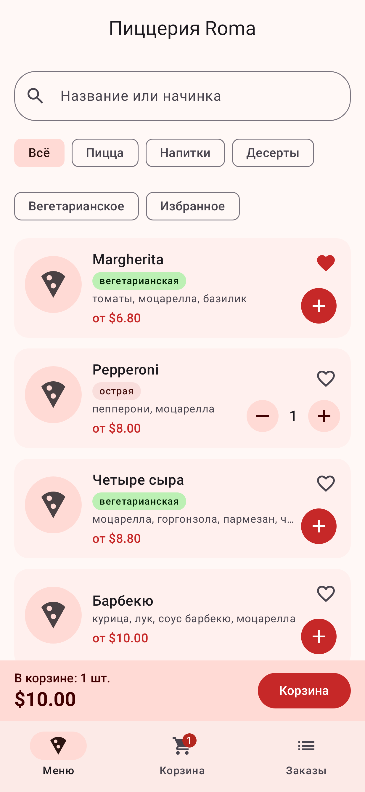
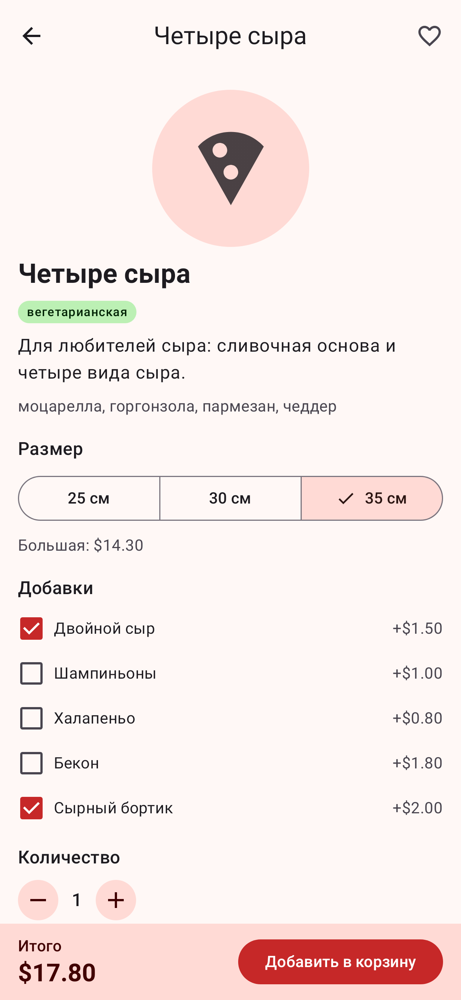
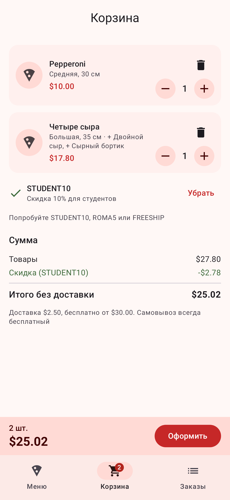
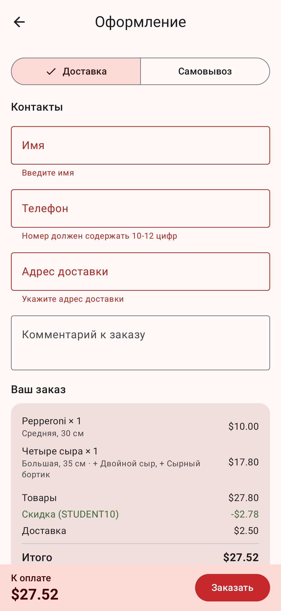
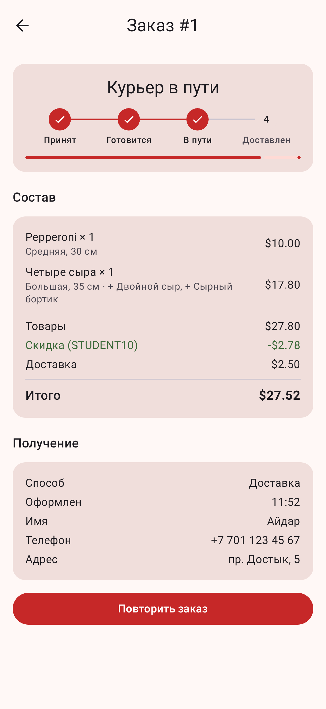
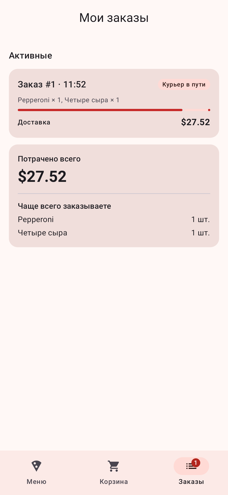

# Pizzeria Roma (Midterm, Part 1)

An Android app for ordering food from a pizzeria, built with Kotlin, Jetpack Compose, Material 3, Navigation Compose and ViewModel + StateFlow. It continues HW1 (the console pizzeria) and HW2 (the first Compose version).

The user can find a dish in the menu, customize a pizza (size and extra toppings), collect a cart, apply a promo code, choose delivery or pickup, place an order and watch it go through cooking and delivery in real time. Past orders can be repeated in one tap.

## Screenshots

| Menu | Pizza customization | Cart with promo code |
|---|---|---|
|  |  |  |

| Checkout with validation | Order tracking | Orders and stats |
|---|---|---|
|  |  |  |

## Features

1. **Menu with search and filters.** Search by name or topping, category chips (pizza, drinks, desserts), "Vegetarian" and "Favorites" toggles. Labels for vegetarian, spicy and sugar-free dishes. Quick "+" adds a medium pizza and shows a snackbar with a shortcut to the cart.
2. **Favorites.** The heart on a card or on the details screen adds a dish to favorites; the "Favorites" filter shows only them.
3. **Pizza customization.** The details screen lets you pick a size (25 / 30 / 35 cm, the price changes), extra toppings (double cheese, bacon, cheese crust, ...) and quantity. The same pizza with different options becomes separate cart lines.
4. **Cart and promo codes.** Change quantity, delete lines, apply a promo code:
   - `STUDENT10` 10% off,
   - `ROMA5` $5 off for orders from $25 (the app explains when the condition is not met),
   - `FREESHIP` free delivery.
5. **Checkout.** Delivery or pickup (delivery costs $2.50, free from $30). Name, phone and address are validated, errors appear after the first submit attempt. The final price is broken down into items, discount and delivery.
6. **Live order tracking.** After ordering, a coroutine moves the order through "Accepted → Cooking → On the way → Delivered" (pickup skips delivery). The details screen shows a step timeline and progress; the order can be cancelled until it is handed to the courier (with a confirmation dialog).
7. **Order history.** Active and finished orders, total spent and most ordered dishes. "Repeat order" puts the same lines back into the cart.

Badges on the bottom bar show the number of items in the cart and active orders.

## How to run

Requirements: Android Studio (recent, AGP 9), JDK 21, Android SDK 36.

1. Clone the repository and open the folder in Android Studio, wait for Gradle sync.
2. Pick an emulator or a device (Android 8.0+, API 26) and run the `app` configuration.

From the command line: `./gradlew :app:installDebug`.

## Architecture

```
app/src/main/java/com/example/
 ├─ MainActivity.kt              entry point, logs Activity lifecycle
 ├─ PizzeriaApplication.kt       creates the AppContainer
 ├─ contract/Preparable.kt       interface from HW1
 ├─ model/                       MenuItem / Pizza / Drink / Dessert, PizzaSize, Extra,
 │                               OrderLine, Order, PriceQuote, sealed OrderStatus, PromoCode
 ├─ service/Pizzeria.kt          business logic: search, price quote, stats, processOrder
 ├─ data/
 │   ├─ SampleData.kt            menu, extras, promo codes
 │   ├─ MenuRepository.kt        menu + favorites (StateFlow)
 │   ├─ CartRepository.kt        cart lines + applied promo (StateFlow)
 │   ├─ OrderRepository.kt       orders (StateFlow), runs order processing in an app scope
 │   └─ AppContainer.kt          manual dependency injection
 └─ ui/
     ├─ PizzeriaApp.kt           Scaffold, bottom NavigationBar, NavHost
     ├─ navigation/Routes.kt     type-safe routes and top-level tabs
     ├─ AppViewModelProvider.kt  ViewModel factory (repositories + SavedStateHandle)
     ├─ MainViewModel.kt         badges for the bottom bar
     ├─ menu/  details/  cart/  checkout/  orders/   screen + ViewModel per feature
     ├─ components/              reusable composables
     └─ theme/Theme.kt           Material 3 color scheme (light + dark), shapes
```

Layers:

- **UI** (composables) only draws state and sends events up. Each feature has a stateful `XxxScreen` that gets the ViewModel and collects its state, and a stateless `XxxContent` that receives values and callbacks (state hoisting).
- **ViewModels** turn repository flows into a screen state with `combine` / `map` + `stateIn(viewModelScope, WhileSubscribed(5000))` and expose it as `StateFlow`. Screens collect it with `collectAsStateWithLifecycle()`, so collection stops when the app is in the background.
- **Repositories** hold the shared app state in `MutableStateFlow` and are shared between screens (cart is changed on the menu, details, cart and order screens).
- **`Pizzeria`** is plain Kotlin logic without Android dependencies.

Order processing is a `suspend` function started in the application `CoroutineScope` inside `OrderRepository`, not in a ViewModel, because the order must keep going when the user leaves the screen and its ViewModel is cleared.

## Navigation

Navigation Compose with type-safe `@Serializable` routes:

| Route | Screen | Arguments |
|---|---|---|
| `MenuRoute` | menu (start, tab) | |
| `CartRoute` | cart (tab) | |
| `OrdersRoute` | orders (tab) | |
| `ItemDetailsRoute` | dish details | `itemId` |
| `CheckoutRoute` | checkout | |
| `OrderDetailsRoute` | order tracking | `orderId` |

- Tabs are switched with `popUpTo(start) { saveState = true }`, `launchSingleTop` and `restoreState`, so each tab keeps its scroll and filters.
- Arguments are read in the ViewModel with `savedStateHandle.toRoute<ItemDetailsRoute>()`.
- After an order is placed, checkout and cart are removed from the back stack (`popUpTo(CartRoute) { inclusive = true }`), so "Back" from the order screen does not return to an empty checkout.
- The bottom bar is shown only on top-level destinations.

## State: remember, rememberSaveable, ViewModel

| Where | What | Why |
|---|---|---|
| `remember` | `SnackbarHostState` on the menu | UI object, nothing to restore |
| `rememberSaveable` | checkout fields, "submitted" flag, promo code input, cancel dialog | the user expects typed text and an open dialog to survive rotation and process death |
| `SavedStateHandle` | selected size, extras and quantity on the details screen, delivery type at checkout | screen state that lives in the ViewModel but must survive process death |
| ViewModel / repositories | menu filters, cart, favorites, orders | survive configuration changes, shared between screens |

## Configuration changes

Rotate the device at any step:

- the back stack and the current tab stay (NavController state is saved);
- ViewModels are reused: filters, search text, cart and selected options are kept;
- typed checkout fields and validation errors are kept (`rememberSaveable`);
- orders keep progressing, because the coroutine does not depend on the Activity.

Logcat (tag `PizzeriaLifecycle`) shows `onDestroy, isChangingConfigurations=true` and a new `onCreate` on each rotation, while `MainViewModel created` appears only once.

Data is kept in memory for now, so after the process is killed the cart and orders are empty. A database is planned for the second part of the course.

## Reusable components

`PizzeriaTopBar`, `SummaryBar`, `EmptyState`, `SectionTitle`, `InfoLabel`, `LabeledCheckbox`, `QuantityStepper`, `PriceRow`, `PriceBreakdown`, `SearchField`, `CategoryFilterRow`, `ToggleChip`, `MenuItemImage`, `FavoriteButton`, `ItemLabels`, `MenuItemCard`, `CartLineCard`, `PromoCodeField`, `OrderCard`, `StatusLabel`, `StatusTimeline`, `OrderLineRow`, `StatsCard`.

## Kotlin features used

- abstract class, inheritance and interface (`MenuItem`, `Pizza`, `Preparable`), enums with properties (`PizzaSize`, `Category`, `DeliveryType`), sealed class `OrderStatus` with exhaustive `when`, data classes with `copy`.
- extension functions and properties (`priceFor`, `formatPrice`, `isVegetarian`, `toText`).
- higher-order functions and lambdas (`filterMenu(predicate)`, promo code `discountRule`).
- collections: `filter`, `map`, `groupBy`, `partition`, `sumOf`, `flatMap`, `mapValues`, sets of favorites and extras.
- coroutines and flows: `delay`, `launch`, `Job.cancel`, `MutableStateFlow.update`, `combine`, `map`, `stateIn`.
