# Pizzeria Roma (MVVM + Room)

An Android app for a pizzeria, built with Kotlin, Jetpack Compose, Material 3, Navigation Compose, ViewModel + StateFlow and Room. It continues HW1 (the console pizzeria), HW2 (the first Compose version) and the midterm (multi-screen app with navigation).

The customer side works as before: find a dish, customize a pizza, collect a cart, apply a promo code, place an order and watch it being cooked and delivered. This version adds:

- **Room database.** Menu, recipes, ingredients, stock history, cart, favorites and orders are stored locally and survive a restart.
- **Menu management (CRUD).** Dishes can be created, edited and deleted (with confirmation) through a validated form.
- **Additional feature: ingredient inventory with transactions.** Every dish has a recipe, every order takes its ingredients from the stock, and the app does not let you order what the kitchen cannot cook.

## Additional feature: inventory with stock transactions

The new **Склад** (Stock) tab tracks every ingredient of the pizzeria. It ties the menu, the cart and the orders together:

1. **Recipes link dishes and ingredients** (many-to-many). In the dish form you add ingredients and the amount per portion. For pizzas the amount is for 30 cm and is scaled for 25 cm (×0.8) and 35 cm (×1.3).
2. **The menu knows what is left.** The app calculates how many more portions each dish allows, taking into account what is already in the cart. Dishes get an "Осталось N" or "Нет в наличии" label and the "+" button is disabled when the stock is empty. On the details screen you cannot add more than the stock allows ("На складе хватит на 4 шт.").
3. **Placing an order is one Room transaction:** the stock is checked again, the order is saved, an `ORDER` transaction is written for every ingredient and the stock is reduced, the cart is cleared. If something ran out in the meantime, nothing is saved and the user sees what is missing. The cart and checkout also show a warning card and disable checkout when the cart needs more than the stock has.
4. **Cancelling an order returns the ingredients:** for each ingredient the order took, a `RETURN` transaction gives it back.
5. **Restock and write-off.** On an ingredient's screen you can add a delivery (`RESTOCK`) or write off spoiled stock (`WRITE_OFF`, a reason is required and you cannot write off more than you have).
6. **History and statistics.** Each ingredient shows its full operation history, totals (received, used in orders, returned, written off), and the dishes that use it with "enough for N portions". The stock tab shows counters (positions, running low, out of stock, orders served) and the latest operations, where all transactions of one order are grouped into one entry. A badge on the tab shows how many ingredients need attention.
7. **Ingredients are CRUD too:** create (with a starting stock), edit name and low-stock threshold, delete with confirmation (the dialog says how many recipes use it).

The stock is never edited directly: it only changes through transactions, so the history always explains the current amount.

### Screenshots of the feature

| Stock tab: counters, grouped history, alerts | Ingredient: stock, totals, dishes, history | Menu after the cart took the last salami |
|---|---|---|
| 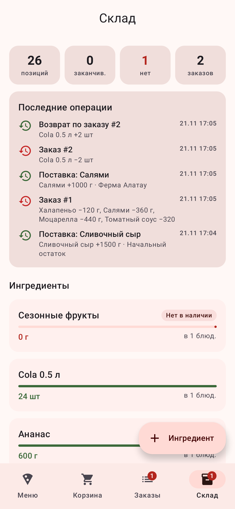 | 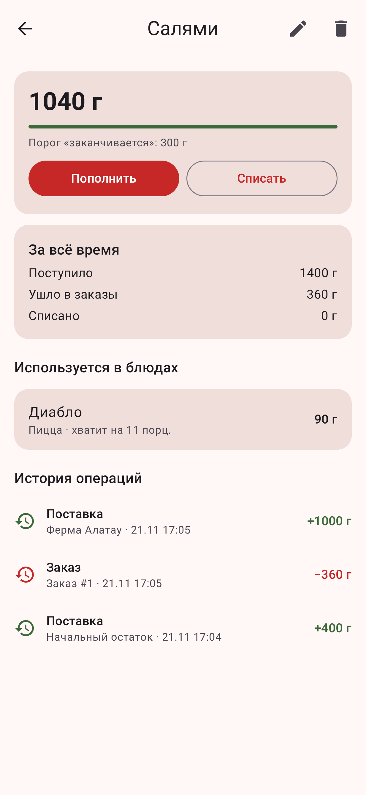 | 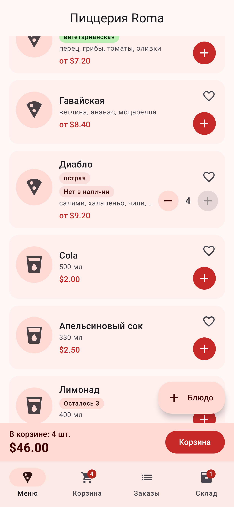 |

| Quantity limited by the stock | Cancelling returns ingredients | Dish recipe in the form |
|---|---|---|
| 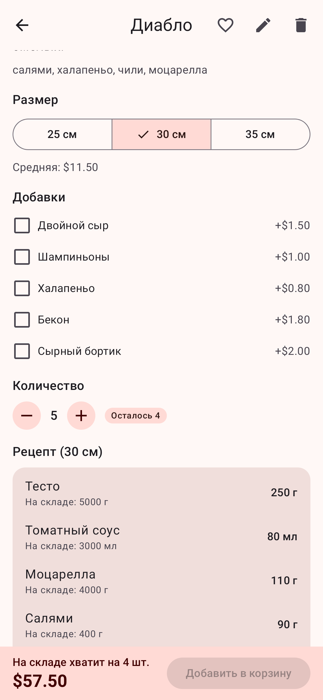 | 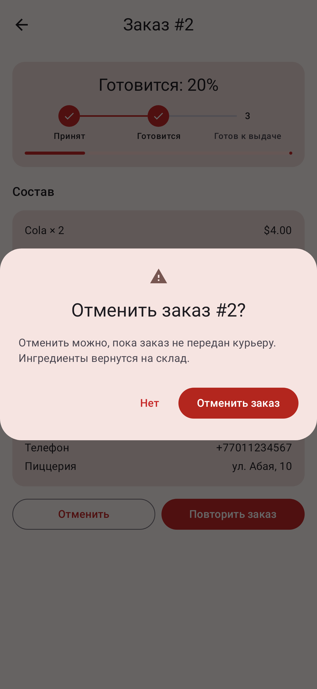 | 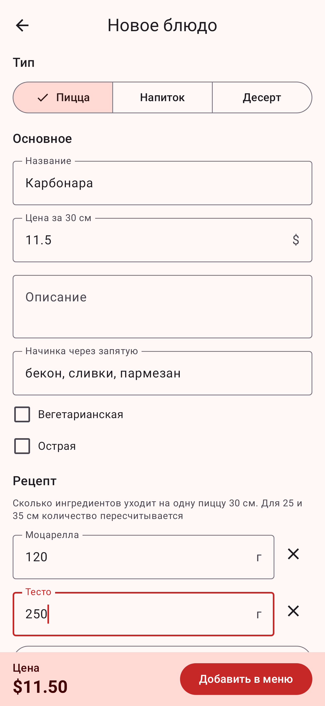 |

In the first screenshot order #1 (4 × Диабло) took 360 g of salami and other ingredients, then 1000 g of salami were delivered, and order #2 (2 × Cola) was cancelled, so the 2 bottles came back.

## Menu management (CRUD)

| Validation | Created dish with its recipe | Delete with confirmation |
|---|---|---|
| 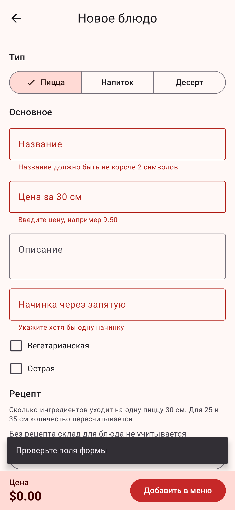 | 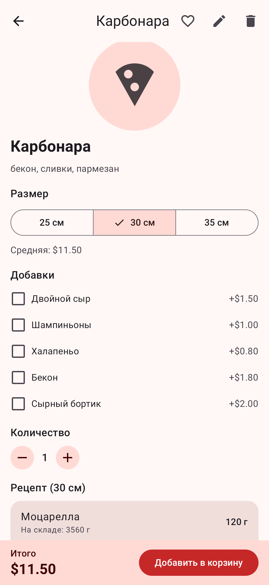 | 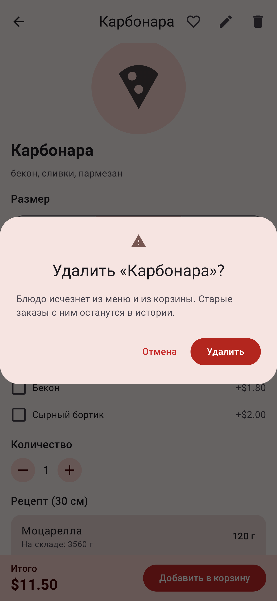 |

- **Create:** the "Блюдо" button on the menu opens an empty form. After saving, the new dish's details screen opens.
- **Read:** the menu list (`LazyColumn` with `key = { it.id }`) and the details screen.
- **Update:** the pencil on the details screen opens the same form filled with the dish. Changes appear on the menu, details, cart and stock screens at once, because they all observe Room flows.
- **Delete:** the bin on the details screen asks for confirmation. The dish disappears from the menu and the cart (foreign key `CASCADE`); old orders keep a snapshot of the dish, so the history stays correct.

Validation: name 2–40 characters and unique (case-insensitive), price $0.50–$500 (accepts `9.5` and `9,5`), description up to 200 characters, at least one topping for a pizza, 50–3000 ml for a drink, every recipe amount greater than 0. Errors appear after the first save attempt, and a snackbar says "Проверьте поля формы". The dish type cannot be changed after creation.

## Other screens

| Menu | Cart | Checkout |
|---|---|---|
| 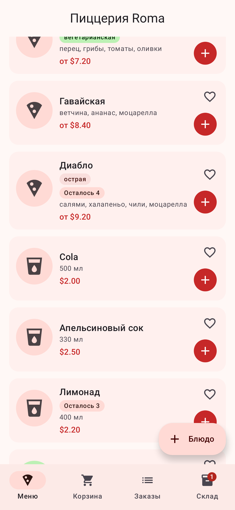 | 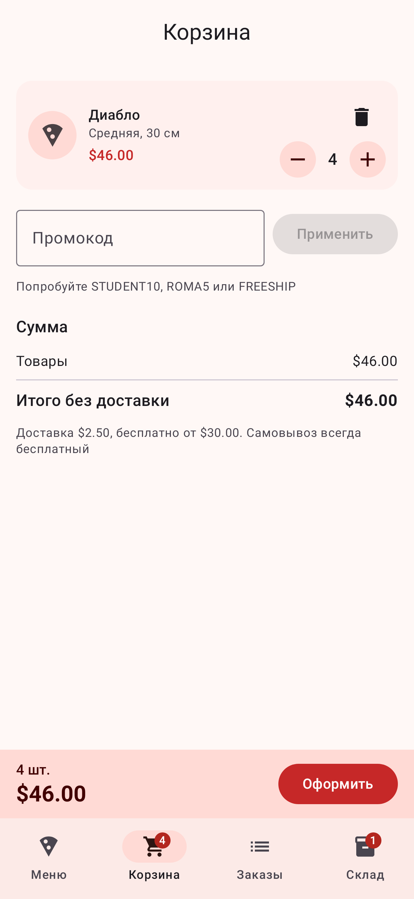 | 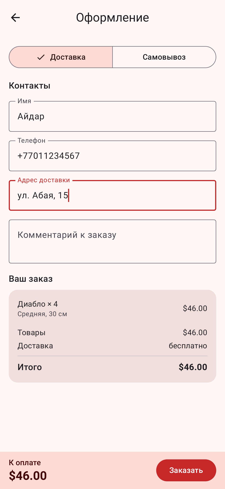 |

| Order tracking | Orders and stats |
|---|---|
| 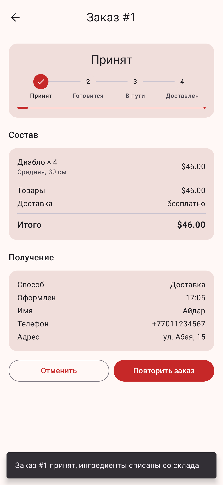 | 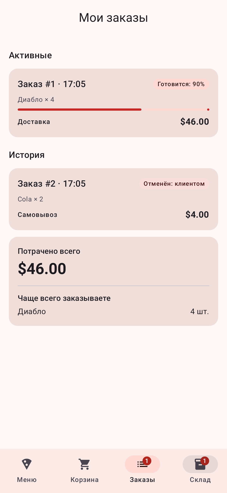 |

## All features

1. **Menu** with search by name or topping, category chips, "Vegetarian" and "Favorites" filters, stock labels, quick "+" with a snackbar shortcut to the cart.
2. **Favorites** (stored in Room).
3. **Pizza customization:** size, extra toppings, quantity, recipe for the selected size.
4. **Cart** (stored in Room) with promo codes `STUDENT10` (10%), `ROMA5` ($5 off from $25), `FREESHIP` (free delivery) and a stock check.
5. **Checkout** with delivery or pickup and validated name, phone and address.
6. **Live order tracking:** "Accepted → Cooking → On the way → Delivered", cancel with confirmation while the order is not with the courier.
7. **Order history** with total spent and most ordered dishes; "Repeat order" puts the dishes back into the cart (dishes that were deleted from the menu are skipped and reported).
8. **Menu management** (create, edit, delete dishes and their recipes).
9. **Inventory** (see above).

Every user action gets feedback: snackbars for saved, deleted, restocked, ordered, cancelled; loading indicators while Room loads data; empty states for an empty menu, cart, order list, stock, recipe and history.

## Architecture

```
app/src/main/java/com/example/
 ├─ MainActivity.kt, PizzeriaApplication.kt
 ├─ model/                       MenuItem / Pizza / Drink / Dessert, Order, OrderStatus,
 │                               Ingredient, RecipeEntry, StockTransaction, Shortage, DishType
 ├─ service/
 │   ├─ Pizzeria.kt              search, price quote, stats, order processing
 │   └─ StockCalculator.kt       requirements of a cart, shortages, portions left
 ├─ data/
 │   ├─ local/                   Room: entities, DAOs, PizzeriaDatabase, mappers, DatabaseSeeder
 │   ├─ MenuRepository.kt        dishes, favorites, recipes
 │   ├─ InventoryRepository.kt   ingredients, transactions, restock / write-off
 │   ├─ CartRepository.kt        cart lines (Room) + applied promo code
 │   ├─ OrderRepository.kt       orders, place / cancel / repeat, order processing
 │   ├─ SampleData.kt            first-launch data and static data (extras, promo codes)
 │   └─ AppContainer.kt          manual dependency injection
 └─ ui/
     ├─ PizzeriaApp.kt           Scaffold, bottom bar with badges, NavHost
     ├─ navigation/Routes.kt     type-safe routes
     ├─ AppViewModelProvider.kt  ViewModel factory
     ├─ common/UserMessages.kt   feedback messages from ViewModels to the snackbar
     ├─ menu/ details/ editor/ cart/ checkout/ orders/ inventory/   screen + ViewModel per feature
     ├─ components/              reusable composables
     └─ theme/
```

- **UI.** Each feature has a stateful `XxxScreen` that gets its ViewModel and collects the state with `collectAsStateWithLifecycle()`, and a stateless `XxxContent` that only receives values and callbacks (state hoisting). Composables never touch repositories: every action is a ViewModel method (`viewModel::save`, `viewModel::applyOperation`, ...).
- **ViewModels** combine repository flows with `combine` / `map` and expose one `StateFlow<XxxUiState>` with `stateIn(viewModelScope, WhileSubscribed(5000))`. Form state (dish and ingredient forms) lives in the ViewModel as a `MutableStateFlow`, so it survives rotation.
- **Repositories** are the only classes that use DAOs. Reads are Room `Flow`s, so a change made on any screen reaches every other screen automatically. Writes are `suspend` functions that run in the application scope (`runDetached`), so a save or delete finishes even if the user leaves the screen right after the click.
- **`Pizzeria` and `StockCalculator`** are plain Kotlin without Android dependencies and are covered by unit tests.

### Room database

| Table | What it stores | Relations |
|---|---|---|
| `menu_items` | dishes (type, name, price, description, toppings, flags, favorite) | |
| `ingredients` | name, unit (g / ml / pcs), stock, low-stock threshold | |
| `recipe_items` | amount of an ingredient per portion of a dish | FK to dish and ingredient, `CASCADE` |
| `stock_transactions` | type (restock, write-off, order, return), delta, order id, note, time | FK to ingredient, `CASCADE` |
| `cart_lines` | dish, size, extras, quantity | FK to dish, `CASCADE` |
| `orders` | customer, delivery type, prices, promo code, status | |
| `order_lines` | snapshot of the dish (name, type, price), size, extras, quantity | FK to order, `CASCADE`; read with `@Relation` |

DAOs: `MenuDao`, `InventoryDao`, `CartDao`, `OrderDao`. Multi-step writes are `@Transaction` DAO methods or `withTransaction` blocks (saving a dish with its recipe, placing and cancelling an order, a restock or write-off together with the stock change). The dishes that use an ingredient are loaded with a `JOIN` query. The schema is exported to `app/schemas/`.

On the first launch `DatabaseSeeder` fills the database with the menu, 26 ingredients (each starting amount is written as a transaction), and the recipes. Some ingredients start low on purpose (salami for 4 Diablo pizzas, lemons for 3 lemonades, no fruit for the fruit salad) so the feature is visible right away.

### What survives a restart

Menu changes, recipes, favorites, stock and its history, the cart and all orders. Orders that were being cooked or delivered when the app was closed continue from their saved status. Only the applied promo code is kept in memory.

## Navigation

| Route | Screen | Arguments |
|---|---|---|
| `MenuRoute` | menu (start, tab) | |
| `CartRoute` | cart (tab) | |
| `OrdersRoute` | orders (tab) | |
| `InventoryRoute` | stock (tab) | |
| `ItemDetailsRoute` | dish details | `itemId` |
| `MenuItemEditRoute` | create / edit dish | `itemId` (0 = new) |
| `CheckoutRoute` | checkout | |
| `OrderDetailsRoute` | order tracking | `orderId` |
| `IngredientDetailsRoute` | ingredient, history | `ingredientId` |
| `IngredientEditRoute` | create / edit ingredient | `ingredientId` (0 = new) |

Dish details link to the ingredients of the recipe, and an ingredient links back to the dishes that use it. After creating a dish or ingredient the form is replaced by its details screen (`popUpTo<...EditRoute> { inclusive = true }`); after editing, the form closes. Tabs keep their own back stack and scroll position.

## State and configuration changes

| Where | What |
|---|---|
| Room | everything the user creates or changes |
| ViewModel | menu filters, form state of the dish / ingredient editors |
| `SavedStateHandle` | selected size, extras and quantity on the details screen, delivery type at checkout, route arguments |
| `rememberSaveable` | checkout fields, promo code input, open dialogs, typed values in the restock dialog |

Rotating the device keeps the back stack, the ViewModels and all typed values.

## Tests

`./gradlew :app:testDebugUnitTest` runs JUnit tests for `StockCalculator` (requirements scaled by size, shortages, portions left, rounding) and for form validation (dish, drink, ingredient, restock and write-off rules).

During development the whole flow was also run end to end in Robolectric with Compose UI tests: placing an order took the ingredients, cancelling returned them, restock, creating, validating and deleting a dish, and a second database instance confirmed that everything was written to disk. The screenshots above come from that run.

## How to run

Requirements: Android Studio (recent, AGP 9), JDK 21, Android SDK 36.

1. Clone the repository and open the folder in Android Studio, wait for Gradle sync.
2. Pick an emulator or a device (Android 8.0+, API 26) and run the `app` configuration.

From the command line: `./gradlew :app:installDebug`.

The database is created on the first launch. To start over, clear the app data in the system settings.

## Kotlin features used

- abstract class, inheritance and interface (`MenuItem`, `Pizza`, `Preparable`), enums with properties, sealed classes (`OrderStatus`, `PlaceOrderResult`) with exhaustive `when`, data classes with `copy`.
- extension functions and properties (`priceFor`, `portionFactor`, `formatAmount`, `toModel` / `toEntity` mappers).
- higher-order functions and lambdas, collections (`groupBy`, `groupingBy().eachCount()`, `associateBy`, `partition`, `flatMap`, `minOf`, `sumOf`).
- coroutines and flows: `suspend` DAO methods, Room `Flow`, `combine`, `stateIn`, `async` / `await` in the application scope, `cancelAndJoin`, `Channel` for one-time messages.
